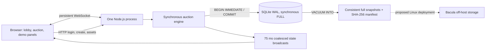
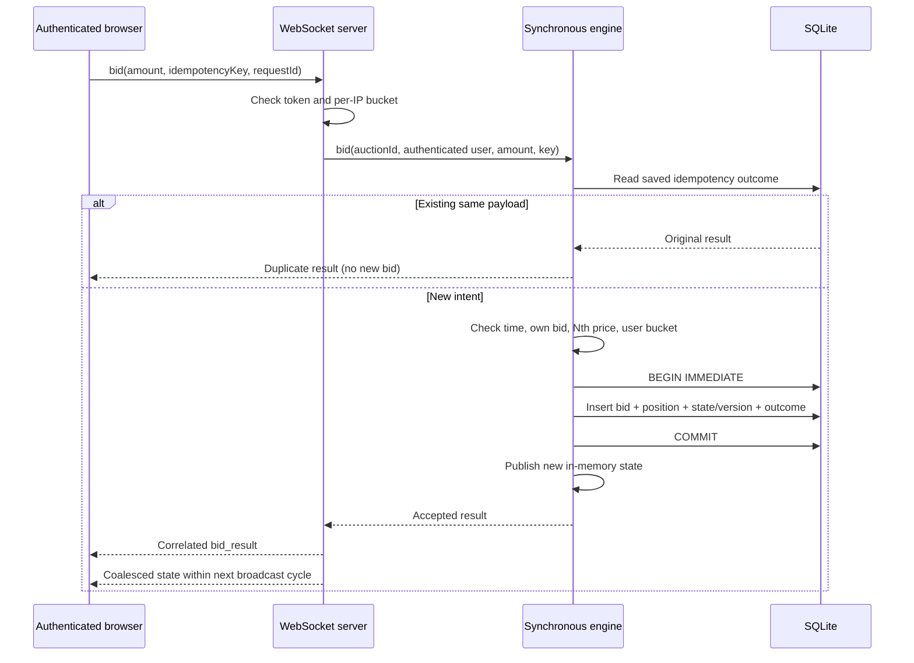

# Architecture and consistency

## Implemented topology

The app uses built-in `http`, `crypto`, `node:sqlite`, `node:test`, and `ws` as its
only npm dependency. Assets are served locally, with no font/CDN dependency.
The browser still needs a connection to this local server: this is not the offline CEP 2.

## Bid path

No `await`, callback, or asynchronous I/O occurs between reading the bid's current
state and committing its replacement. One JavaScript event-loop callback runs to
completion before another callback executes. The synchronous SQLite transaction
commits all bid records together; memory changes only after COMMIT. On failure the
transaction rolls back. Node's DatabaseSync operations are synchronous by definition.
[Node SQLite reference](https://nodejs.org/api/sqlite.html)

This reasoning depends on **one engine owner**. A PID lock prevents a second process
from opening that database as another engine. It is not a distributed lock. Running
cluster workers with separate memory copies would invalidate the argument. Do not do it.

Finalization runs every 250 ms on the same event loop and in a transaction: orders and
the ended state/version commit together. Bids independently reject at `now >= endsAt`,
so a delayed timer does not allow late bids. Startup reconstructs all auctions/positions
from SQLite and finalizes overdue auctions. Repeated finalization does not duplicate orders.

## Acknowledgements, ordering and durability

- Acceptance is sent after a WAL transaction COMMIT with `synchronous=FULL`.
  An acknowledgement lost in transit can be retried with the same key.
- A power/disk/host disaster can still lose data; durability depends on functioning
  filesystem/hardware, and local WAL is not an off-host backup.
- Every accepted bid adds one version. Finalization adds one. Rejections and duplicate
  retries do not change auction state. Coalescing deliberately skips intermediate
  versions; a client must not require contiguous version delivery.
- Full authoritative snapshots are sent on subscription/reconnect. A boot UUID epoch
  changes on server restart, allowing clients to accept a restored older version.
- `requestId` correlates responses; `idempotencyKey` identifies one intent. They are
  separate. A newer state must not cause a bid acknowledgement to be discarded.
- The browser buffers at most 20 pending intents and resends them after reconnect
  with their original keys. Rate limits are memory-only and reset on server restart.
- Leaderboard ranking retains a user's best accepted bid, with bounded top N <= 100
  and last 30 bid points in each snapshot. Full history is stored in SQLite.

## Communication and resource limits

WebSockets let the server push accepted state changes. The UI does not poll auction
HTTP endpoints. A pushed clock message every second corrects the client's local countdown.
WS ping/pong every 15 seconds detects dead peers. Socket payloads are limited to 8 KiB;
HTTP JSON bodies to 16 KiB; max outgoing buffered data to 256 KiB. Slow clients are
terminated and can reconnect to a fresh snapshot. Unauthenticated connections have
5 seconds to authenticate. Defaults: 3,000 sockets total and 2,500 per IP.
Shutdown stops timers, closes sockets and HTTP connections, then closes SQLite.

WebSocket transport alone does not prevent races. The unsafe REST comparison injects
an asynchronous delay between reading and writing a stale state. A correctly built
REST endpoint using atomic database transactions could be equally correct.
The comparison is about correctness, not a fair transport speed benchmark.

## Scale target and design-only next steps

50,000 concurrent bidders is the assignment's target, **not achieved capacity**.
Actual runs and their latency limits are recorded in `results/`. Even 500 connections
can create a queue under a simultaneous durable-write burst. Idle connection count
and bids/second are different measures. The load generator shares the process with
the server, so event-loop starvation also delays the generator and its timings.

A connection-count projection is `ceil(50,000 / measured_connections_per_node)`.
At 2,000 connections this arithmetic is 25 nodes; at 500 it is 100. These are scenarios,
not promises: neither accounts for the measured latency, shared storage, fan-out,
network bandwidth, failure headroom or one hot auction. Combined-process RSS in the
report cannot be treated as isolated server memory per connection.

A future distributed design could use nginx and multiple WS nodes, Redis Lua for
atomic bid validation/state/event creation, Redis Streams for durable consumer
processing, and an external durable SQL database. Redis Cluster can shard separate
auctions, but one hot auction still needs a single ordered decision point. Kafka can
provide a partitioned event log, while multi-region operation needs an explicit
ordering/leader policy and conflict/failure design. All are future design work here.

## Known limitations

Single writer, synchronous disk blocking, wall-clock sensitivity to OS time changes,
mock selectable admin identities, localhost HTTP without TLS, no payment processing,
no distributed failover, no multi-host tests, no history pagination/retention (1,000
auction creation cap), no production secret management, and same-machine backup media.
Bacula files are realistic templates, not an installed or verified Bacula deployment.
